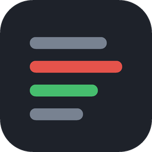

# Arnold

**Review your agent's F# with the compiler at your side.**

Arnold is a desktop app for macOS and Windows, made for the work AI agents leave behind. Every diff is a real F# editor (errors, hover, go to definition, rename, quick fixes and Fantomas) while you commit the agent's changes line by line, review the branch and see its Azure DevOps pull request through to completion. GitHub Copilot, through your organization's own subscription, explains any of it on request.

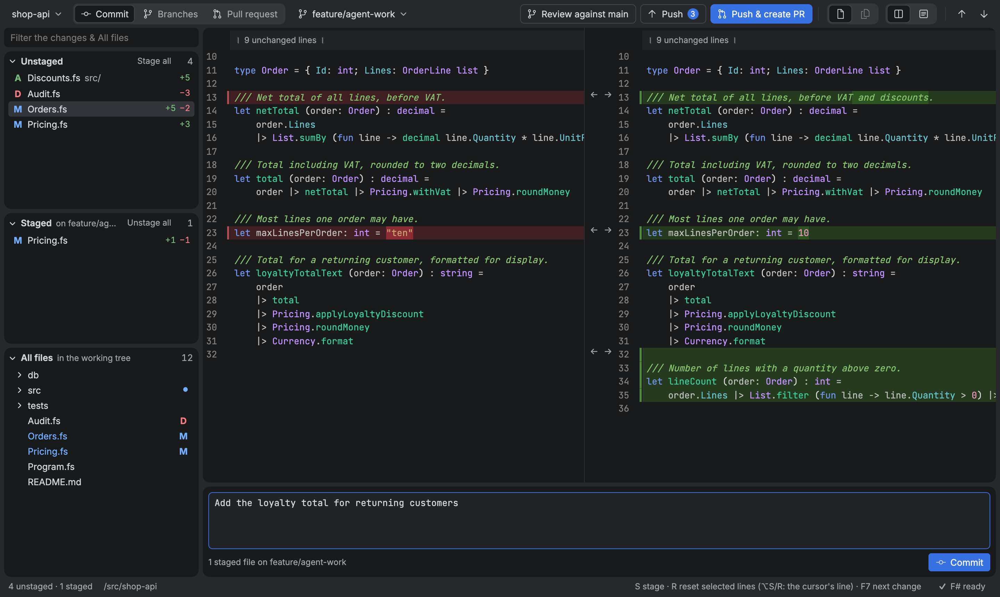

## Highlights

**F#, first class.** Most diff viewers show F# as colored text. Arnold runs [FsAutoComplete](https://github.com/ionide/FsAutoComplete), the language server behind Ionide, in every diff: in Commit mode, in a branch review and in a pull request. Errors as you read, hover, go to definition, find references, rename everywhere, quick fixes, completion and semantic colors. In repositories that use [Fantomas](https://fsprojects.github.io/fantomas/), committing checks the formatting first and can format exactly what is committed.

**Zero setup.** Nothing to install but the .NET SDK. Arnold downloads FsAutoComplete itself, and branches and pull requests get a real checkout (a worktree of their own when they need one), with tools and packages restored, so the language server sees your projects as they are.

**The whole way, in one window.** Commit what the agent left uncommitted, review the branch, push, open the pull request and review it until it is completed.

**Commit, line by line.** An agent's uncommitted changes in Unstaged and Staged lists, editable in the diff, with `S`, `U` and `R` to stage, unstage and reset files or single lines, as in Git Extensions. Changes made by the agent, an editor or a terminal show up as they happen.

**Compare branches.** Any branch against the branch it goes into, as its pull request will show it: merge-base → the branch's last commit, one file at a time or every file in one scrolling list, narrowed to some of its commits if you like, with `F7` to step from change to change across files. A branch checked out nowhere else is checked out in your folder when you pick it, so you can always fix things right in the diff; if your folder has uncommitted changes, Arnold asks first (see [Checking out](#checking-out)).

**Azure DevOps pull requests.** Create them with a Markdown description and a linked work item; then the active pull requests, their discussions in the diff, comments on lines and files, suggestions, votes, and completing with the merge type of your choice.

**Explain and improve with your organization's Copilot.** Select code, right-click a file or folder, or ask about all the changes, and GitHub Copilot explains them in a panel beside the diff, with follow-up questions. *Suggest improvements* has Copilot review the changes: where they depart from the repository's own patterns, or there is a well-proven reason, a suggestion shows under the lines in the diff, saying why, for you to accept or discard. Arnold has no AI service of its own: it uses the Copilot your organization already provides, so code goes only to GitHub Copilot, under your organization's agreement and policies.

**Safe by default.** Checking out never throws work away unasked: when the opened folder has uncommitted changes, Arnold offers a worktree of its own or stashing them instead, and discarding them takes a second, red confirmation. Otherwise only Commit mode writes, and only when you ask. Nothing is ever force-pushed.

**Keyboard first.** `F7` for the next change across files, `S`/`U`/`R` to stage, unstage and reset, and the F# keys you know from Rider and Visual Studio.

**Contents:** [Install](#install) · [Getting started](#getting-started) · [Committing](#committing) · [Comparing branches](#comparing-branches) · [Azure DevOps pull requests](#azure-devops-pull-requests) · [F#](#f) · [Explaining and improving code with AI](#explaining-and-improving-code-with-ai) · [Keyboard shortcuts](#keyboard-shortcuts) · [What Arnold writes](#what-arnold-writes) · [Status](#status) · [License](#license) · [Development](#development)

## Install

Download the installer from [arnoldapp.dev](https://arnoldapp.dev) or [Releases](https://github.com/reaptor/arnold/releases): the `.pkg` for macOS (Apple silicon), the `-setup.exe` or `.msi` for Windows (x64). Arnold needs `git` on the PATH, and the .NET SDK (8 or newer) for F# language features.

- **macOS:** the build is not signed with a developer certificate yet. Try to open the `.pkg` once, then choose *Open Anyway* under *System Settings → Privacy & Security*.
- **Windows:** the installers are signed by Reaptor AB. While Arnold is new, SmartScreen may still show *Windows protected your PC*; choose *More info → Run anyway*.

### Start from a terminal

The installers put two commands on the PATH, `arnold` and the shorter `ace`:

```bash
arnold path/to/repository
```

```bash
ace .
```

Without a folder they open the current one. Terminals that were open during the installation have to be reopened first. Started from the Dock or the Start menu instead, Arnold reopens the last repository.

| | Where the commands are | Uninstalling |
|---|---|---|
| macOS | links in `/usr/local/bin` to a script inside `Arnold.app` | delete `/Applications/Arnold.app`, `/usr/local/bin/arnold` and `/usr/local/bin/ace` |
| Windows | `bin` inside the installation folder, which is added to PATH (the user's for the `-setup.exe`, the machine's for the `.msi`) | the uninstaller takes the folder off PATH again |

## Getting started

1. **Open a repository:** with `arnold <folder>`, or the repository button at the left of the toolbar. Star a repository there to keep it in your favorites for switching between them.
2. **Pick a mode** in the toolbar:
   - *Commit*: the uncommitted changes of a checkout, to go through and commit (see [Committing](#committing)).
   - *Branches*: a branch against the base branch it goes into (see [Comparing branches](#comparing-branches)).
   - *Pull request*: shown when a remote of the repository is on Azure DevOps (also one added while Arnold is open); one of its active pull requests (see [Azure DevOps pull requests](#azure-devops-pull-requests)).
3. **Go through the changes:** pick files in the dock or scroll the all-files list, and step from change to change with `F7`.

A repository with uncommitted changes opens in *Commit*. Otherwise it opens on the branch checked out in its folder, against the base branch you picked last (or its default branch). Arnold puts the window back where it was.

### The whole way: from an agent's work to a pull request

1. **Commit:** the repository opens in *Commit* when the agent left uncommitted changes. Go through *Unstaged*, fix what needs fixing right in the diff, stage with `S` (files, or selected lines), write the message and commit with `Ctrl+Enter` (`⌘Enter`). If the repository uses Fantomas and the code base is not formatted, Arnold asks first: *Run Fantomas and commit*, *Commit without formatting* or *Cancel*.
2. **Review:** *Review against main* in the toolbar shows the branch as its pull request will: every change since it left main, one file at a time or all at once, with F# language features.
3. **Push:** *Push* in the toolbar, with the number of commits it sends, pushes the branch (and sets its upstream the first time).
4. **Create the pull request:** *Push & create PR* in *Commit*, or *Create pull request* in *Branches*: title, Markdown description, draft or not, and an optional work item to link. Once the branch has an active pull request the button reads *View PR* / *View pull request* and opens it instead.
5. **Review the pull request:** in *Pull request*, colleagues' discussions show in the diff; comment, vote and complete from Arnold.

## Committing

An agent usually leaves its work uncommitted. *Commit*, the first mode in the toolbar, is where it is gone through, fixed and committed, like the commit dialog of [Git Extensions](https://gitextensions.github.io/). The picker next to it chooses the checkout: the opened folder or any other worktree of the repository with a branch checked out (such as an agent's `.claude/worktrees/…`). It lists every other branch too, local and remote: picking one checked out nowhere checks it out in the opened folder, as [Checking out](#checking-out) describes (a remote branch `origin/x` as a local branch `x` that tracks it).

Every branch picker says who made each branch and when it last changed: the creator Azure DevOps records (with a token set up), else who wrote its last commit, and how long ago. *Recent* lists the branches with the latest commits first, *A–Z* by name; the search also finds people. *Fetch* at the bottom fetches every branch of every remote, also in a clone made with `--single-branch`, so new branches can be picked, and brings local branches that are checked out nowhere and only behind their remote up to it.

The files dock has three parts:

- **Unstaged:** what the working tree changes compared with the index, untracked files included (as `A`). A file picked here shows index → working tree, and its working side can be edited: Arnold saves as you type, keeping the file's line endings and byte-order mark.
- **Staged:** what the next commit takes. A file picked here shows the last commit → index, read-only.
- **All files:** every file of the working tree. A file picked here shows the last commit → the file on disk, whatever of it is staged, as Unstaged does when nothing is staged; the whole file, without folding unchanged lines, and editable. A file without changes is shown on its own, as one editor: the diff appears with its first edit and goes again when edits (or undo) take all its changes back, keeping the cursor and undo history either way. Staging and resetting lines is done in Unstaged and Staged.

The parts track each other: a file picked in Unstaged or Staged (by click or arrow keys) is marked in All files too, its folders opened and scrolled to, and a file picked in All files is marked in the lists that hold it, ready for `S`, `U` and `R` there. The editor keeps showing what was picked, and the keyboard stays where it was.

*Commit* starts in the toolbar's *All files* view: every file of Unstaged and then of Staged in one scrolling list, each as it shows when picked in its list (editable with `S` and `R`, or read-only with `U` and `R`), with a *Stage* or *Unstage* button in its header and `F7` stepping from change to change across files. Arrow keys in the lists move through it and the lists follow as you scroll; clicking a file shows it on its own, as in a review, and the choice of view is remembered.

What `S`, `U` and `R` do:

| | In the lists | In the diff |
|---|---|---|
| `S` | Stage the file | Stage the selected lines (the cursor's line without a selection) |
| `U` | Unstage the file | Unstage the selected lines |
| `R` | Reset the file, after asking: unstaged changes are thrown away (an untracked file is deleted); a staged file goes back to the last commit | Unstaged: put the selected lines back as they are in the index, as an edit that undo brings back. Staged: put them back to the last commit in the index and the working tree, after asking |
| `Del` | Delete the file from disk, after asking (on macOS also `⌫`); the index is left as it is, so a tracked file shows up in Unstaged as deleted and *Reset* brings it back | |

Several files of a list can be picked at once: `Ctrl`+click (`⌘`+click) adds or takes away one, `Shift`+click and `Shift+↑`/`↓` pick a run of them, `Ctrl+A` (`⌘A`) the whole list and `Esc` goes back to the file shown. `S`, `U`, `R`, `Del` and the right-click menu (*Stage 3 files*, *Reset 3 files…*, *Delete 3 files…*) then act on all of them.

Where the text can be typed in (the working side of an unstaged file), plain `S` and `R` act on selected lines; with only a cursor they type, and `Alt+S` / `Alt+R` (`⌥S` / `⌥R` on macOS) act on the cursor's line. Both are in the right-click menus too, and *Stage all* / *Unstage all* sit on the list headings. Each change also has arrows that move it to the other side: in the split view between the two sides, in the unified view on the change. In Unstaged, `←` stages the change and `→` resets it to the index (undo brings it back); in Staged, `→` unstages it; in All files, `→` reverts it to the last commit.

Within a change, lines work one by one: selecting some of a change stages or resets only those lines, selecting all of it the whole change.

Write the message at the bottom of *Staged* (drag its top edge to make it taller) and commit with *Commit* or `Ctrl+Enter` (`⌘Enter`); the repository's hooks run.

When the branch is pushed to Azure DevOps and has required branch policies there (reviewers, a build, linked work items…), a push to it would be refused: such a branch takes changes only through pull requests. With a token set up, Arnold checks this before it commits and, if so, offers to *Create branch and commit*, with a name taken from the commit message, or *Cancel*. The new branch starts from the current one and keeps the staged and unstaged changes. If the policies cannot be read (no token, no network), the commit goes ahead as usual.

When the repository uses Fantomas, Arnold checks the formatting before it commits and, if the code base is not formatted, asks whether to format first (see [Fantomas](#fantomas)).

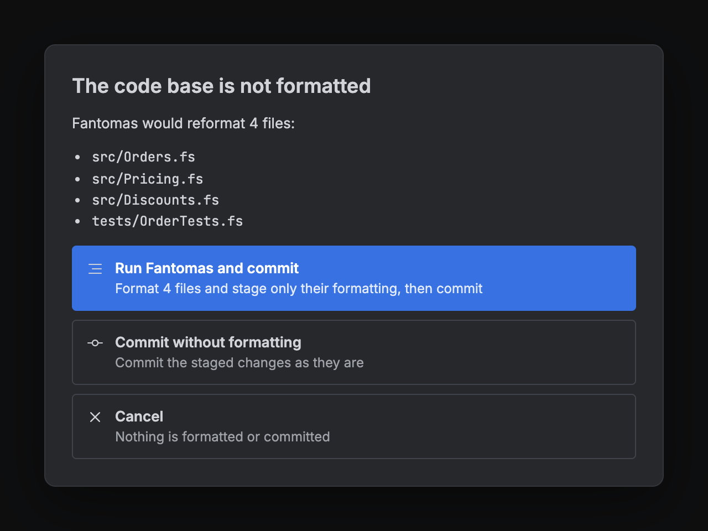

Arnold says what it committed in the status bar and stays in Commit mode. On the right of the toolbar are four buttons for the branch checked out:

- **Review against main** (the repository's default branch): reviews the branch in *Branches*.
- **Pull**, with the number of commits the remote's branch had that the local one lacks at the last fetch: fetches as *Fetch* in the picker does, then brings the branch up to its remote branch. With no commits of its own the branch is fast-forwarded, keeping uncommitted changes in other files; with commits of its own the remote's are merged in, only when nothing is uncommitted, and a merge that conflicts is undone, so nothing changes. Never forced or rebased.
- **Push**, with the number of commits it would send: pushes the branch to its upstream, or to `origin` as a new branch that then becomes its upstream. Never forced: when the remote's branch has commits the local one lacks, the button is off and says to pull first. To an Azure DevOps remote Arnold sends the personal access token it has; otherwise git's own credentials are used.
- **Push & create PR** (with an Azure DevOps remote): pushes as *Push* does, then reviews the branch in *Branches* with the *Create pull request* dialog open. With nothing to push it reads *Create PR*. When the branch has an active pull request already, it reads *Push & view PR* (or *View PR*) and opens that pull request in *Pull request* instead.

The lists follow changes made anywhere: by the agent, an editor or a terminal. In *Commit*, the dock's *All files* explorer opens a file on its own. F# language features work as everywhere else (see [F#](#f)), with completion and signature help while typing; the server runs in the checkout itself and sees edits as they are made.

## Comparing branches

### What is compared

Arnold compares the merge-base of the two branches with the last commit of the reviewed branch, as a pull request does. A new commit or a fetch updates the diff and the branch pickers on their own.

The diff ends at the files of the reviewed branch's checkout instead, so uncommitted edits and untracked files are part of it, and it can be edited: see [Editing while comparing](#editing-while-comparing). That is the opened folder or a linked git worktree when the branch is checked out there; a branch checked out nowhere is checked out when you pick it, as [Checking out](#checking-out) describes (a remote branch `origin/x` as the local branch `x`, made to track it if there is none).

The commit picker narrows the diff to one or more consecutive commits of the branch, as in an Azure DevOps pull request. Tick commits to add them; click a row to see only that commit.

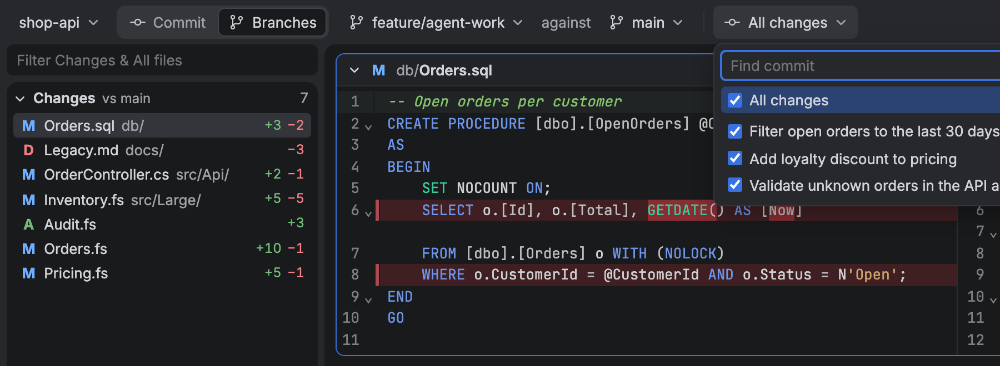

### The files dock

The left side has two parts:

- **Changes:** every file in the diff, with its status (A, M, D, R) and line counts.
- **All files:** a file explorer with every file of the reviewed commit. Changed files are marked with their status and folders holding changes with a dot. Files outside the diff open without a diff, for reading around. Right-click a file or folder for *Add to .gitignore* (in *Commit* and *Branches*): a line ignoring just it goes at the end of the checkout's root `.gitignore`. Git keeps tracking files already committed; *Stop tracking…* (after asking) takes a file or a folder's files out of the repository, staging their removal for the next commit and leaving them on disk.

In a repository with a .NET solution (`.sln` or `.slnx`) or project files, *All files* starts in the **Solution view**, as Rider's solution explorer: the solution's folders and projects in the order of the solution file, each F# project's files in the order of its project file (its compile order, with a folder showing again where its files are listed apart), C# projects by folder, and everything else under *Files outside projects*. An F# file in a project's folder that the project does not list is marked *not in X.fsproj*, as it is not compiled. Changes, and in *Commit* Unstaged and Staged, are listed in the same order. The grid button on the *All files* heading switches to the plain folder tree (files by name) and back; the choice is remembered.

The filter above them applies to both. Drag the gap between them to resize, click a heading to fold a part away, and press `Ctrl+B` to hide or show the whole dock.

### One file or all files

The toolbar switches between one file at a time and *All files*: every file of the diff in one scrolling list, as in a pull request's "all files" view. *All files* is where new reviews start. In it:

- each file has a header that stays in view while you scroll through it; click it to fold the file;
- clicking a file in the dock scrolls to it, and the dock follows as you scroll;
- deleted files start folded;
- files load as they come near the screen, so large diffs stay fast.

### The diff

- Side-by-side or unified. Drag the divider between the sides to resize them; double-click it to make them equal again.
- Compared line by line first, so small edits far apart stay small. Changed words are marked red and green, as in Azure DevOps.
- Added and deleted files show whole; deleted ones are tinted red.
- `F7` / `Shift+F7` step through the changes; in the all-files view they carry on into the next or previous file.
- Long runs of unchanged lines are folded into a *42 unchanged lines* bar; click it to unfold them. An unfolded run has a slim *Hide 42 unchanged lines* bar at its top that folds it again, and *Collapse unchanged lines* in the right-click menu folds the whole file back as it was opened (keeping the lines around discussions unfolded). Lines you edit in an unfolded run are a change of their own, so only the unchanged lines around them can be hidden. Unused opens of an F# file are never folded away, even unchanged: the runs fold around them.
- Marks along the scrollbar show where the changes are (red and green as in the gutter), with errors and discussions in a narrow lane beside them; click one to go there. In the all-files view they cover the whole list, faint for files not loaded yet.
- Syntax highlighting for F#, C#, T-SQL, project and other XML files, JSON and Markdown (with code blocks in their own language), and for about 140 more languages through [`@codemirror/language-data`](https://github.com/codemirror/language-data): JavaScript and TypeScript, Python, Rust, Go, Java, Kotlin, C and C++, PHP, Ruby, Swift, HTML, CSS, YAML, TOML, shell, PowerShell, Dockerfiles and others, chosen by file name. Each is loaded the first time a file needs it.

### Editing while comparing

With *All changes* picked, type straight into the diff (the right side, or the file shown whole). Edits are saved to that checkout as you pause typing, and edits made elsewhere (an editor, an agent) show up in the diff as they happen.

- A file with uncommitted edits is marked **● edited** in Changes, in the explorer and in its header in the all-files view.
- In the diff, the lines your uncommitted edits changed are framed in the same amber, so they stand apart from the branch's committed changes; removed lines leave an amber bar where they were.
- Right-click in the diff for *Undo edits in selected lines* or *Undo all edits to file*: the lines go back to the branch's last commit, as an edit `Cmd+Z` / `Ctrl+Z` can take back. Right-click a file in Changes or the explorer for *Undo edits to file…*, which asks first when the file is not open (a file no commit has is deleted).
- A file from the explorer shows on its own; your first edit turns it into a diff against the merge-base, and undoing the edits turns it back.
- The status bar counts the files with uncommitted edits. Click *Commit…* to go to *Commit* mode on that checkout; its *Review against* button brings you back.
- Otherwise the status bar shows **Read-only**, and typing into the diff says why: a picked run of commits shows commits only, or the branch is not checked out: checking it out failed (*Try again* there) or you cancelled it over uncommitted changes (*Check out…* asks again).
- Worktrees stay where they are when you pick another branch, so going back is quick. Arnold does not remove them; `git worktree remove` does. Git checks a branch out in one place at a time, so a branch that has a worktree is edited there, not in the opened folder; remove the worktree to check it out in the folder again.

### Checking out

A branch or pull request checked out nowhere is checked out in the opened folder, as `git switch` would (a pull request detached at its latest push). Arnold does this in every mode: comparing a branch in *Branches*, opening a pull request, or picking a branch to commit on in *Commit*.

If the opened folder has uncommitted changes (untracked files included), Arnold asks first:

- **Check out in a worktree**: in a git worktree of its own, `.arnold/worktrees/<branch>` (`pr-<id>` for a pull request). Your folder, its branch and its changes are not touched.
- **Stash changes and check out here**: puts every uncommitted change, new files included, on the git stash (*Arnold: before checking out …*), then checks out in the folder. `git stash pop` brings them back.
- **Discard all changes and check out here**: throws every uncommitted change away, new files included, then checks out in the folder. Arnold asks once more before it does, with the button that does it in red (*Back* or `Esc` returns to the choices); this cannot be undone.
- **Cancel**: nothing is checked out, and the diff stays read-only until you check it out from *Read-only* in the status bar.

## Azure DevOps pull requests

When a remote of the repository is on Azure DevOps (dev.azure.com, *.visualstudio.com or Azure DevOps Server, over HTTPS or SSH), the toolbar's *Commit | Branches* switch gets a third choice, *Pull request*.

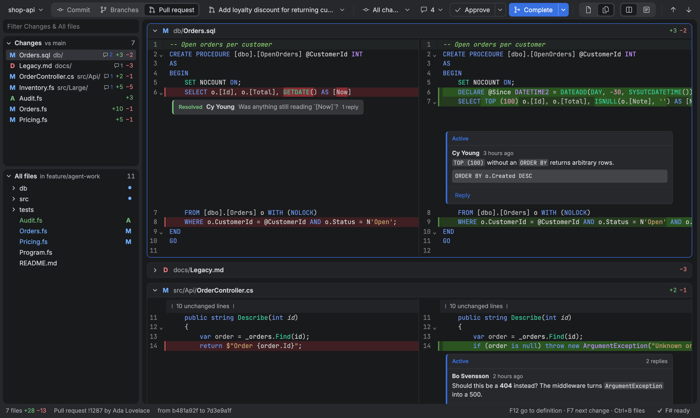

### Connecting

Arnold needs a personal access token. Listing pull requests needs the **Code (Read)** scope; creating pull requests (and pushing their branch), commenting, voting and completing need **Code (Read & write)**; showing a linked work item's title needs **Work Items (Read)** as well (optional). Arnold shows these steps itself when it finds an Azure DevOps remote and has no token:

1. In Azure DevOps, open *User settings → Personal access tokens* (`https://dev.azure.com/<organization>/_usersSettings/tokens`) and select *New Token*.
2. Pick the organization and an expiry date, choose *Custom defined* scopes and tick *Code → Read & write* (or *Read* only, to only read). Create it and copy the token.
3. In Arnold, switch to *Pull request*, paste the token and select *Connect*.

Arnold checks the token with Azure DevOps before saving it, one per organization, in the macOS Keychain or Windows Credential Manager. Without a saved token it uses the `AZURE_DEVOPS_EXT_PAT` environment variable (the Azure CLI's). The token goes only to the remote's Azure DevOps host: to read and change pull requests and to fetch their commits. The key button in the pull request list changes or removes it. HTTPS certificates are checked against the system's certificate store, so company proxies and internal certificate authorities work as they do for git.

### Creating a pull request

Once a branch is reviewed (an AI agent's, say), *Create pull request* in the toolbar opens one on Azure DevOps from the branch to review into the base branch, for colleagues to review. When the branch has an active pull request already (preferably one into the base branch), the button reads *View pull request* and opens it in *Pull request*. The title and description start out as Azure DevOps fills them in (the commit's subject for one commit; otherwise the branch name, with the commits listed), the description is Markdown with a preview, and *Create as a draft* is remembered. An optional *Work item* field links the pull request to a work item: type its number (`1234`, `#1234`, or paste its address) and Arnold shows its type, title and state, and will not create the pull request with a number Azure DevOps does not know. Linking needs no more than the Code scope; showing the title needs *Work Items → Read* on the token, and without it the work item is linked by its number.

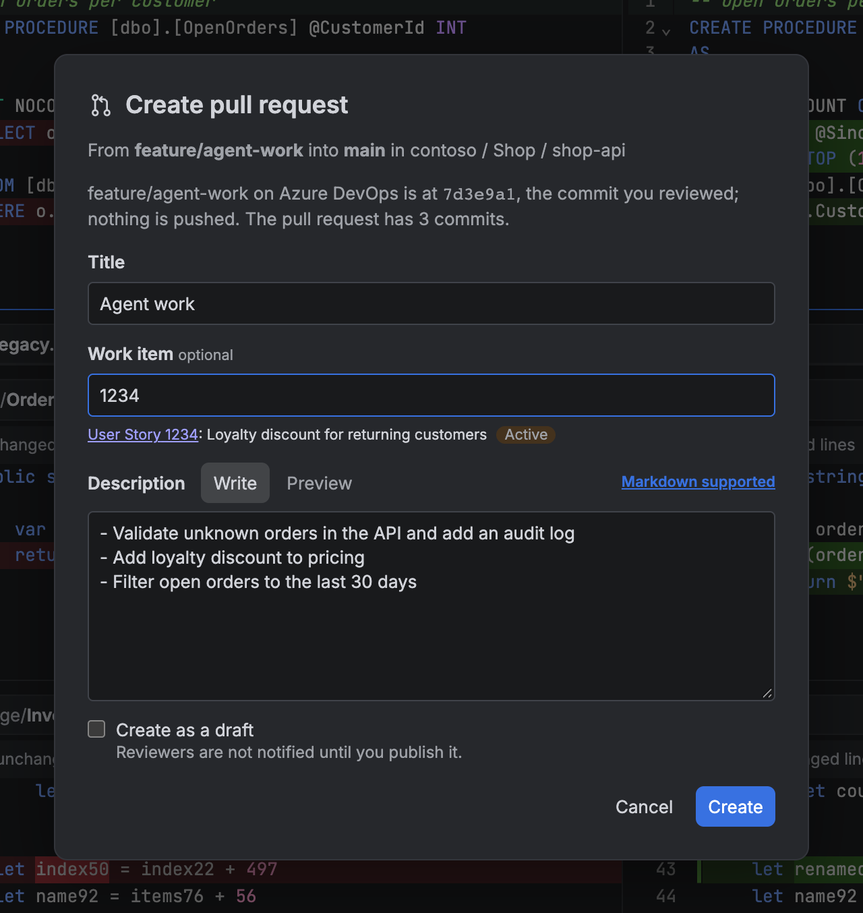

When Azure DevOps does not have the branch yet, or has an older commit of it, Arnold first pushes the commit you reviewed, not whatever the branch points at by now, and says so in the dialog. It never forces: if the branch on Azure DevOps has commits you have not reviewed, nothing is pushed or created. The push goes to the remote's HTTPS address with the token and moves the remote-tracking branch (`origin/<branch>`) along, as `git push` would; the local branch and its upstream setting are left alone. When a pull request between the two branches is open already, the dialog offers to review it instead. The new pull request opens in Arnold.

### Picking a pull request

The list shows the active pull requests with their descriptions, branches, author, votes, drafts and an *Approved* tag; type to find one by title, number, branch or author.

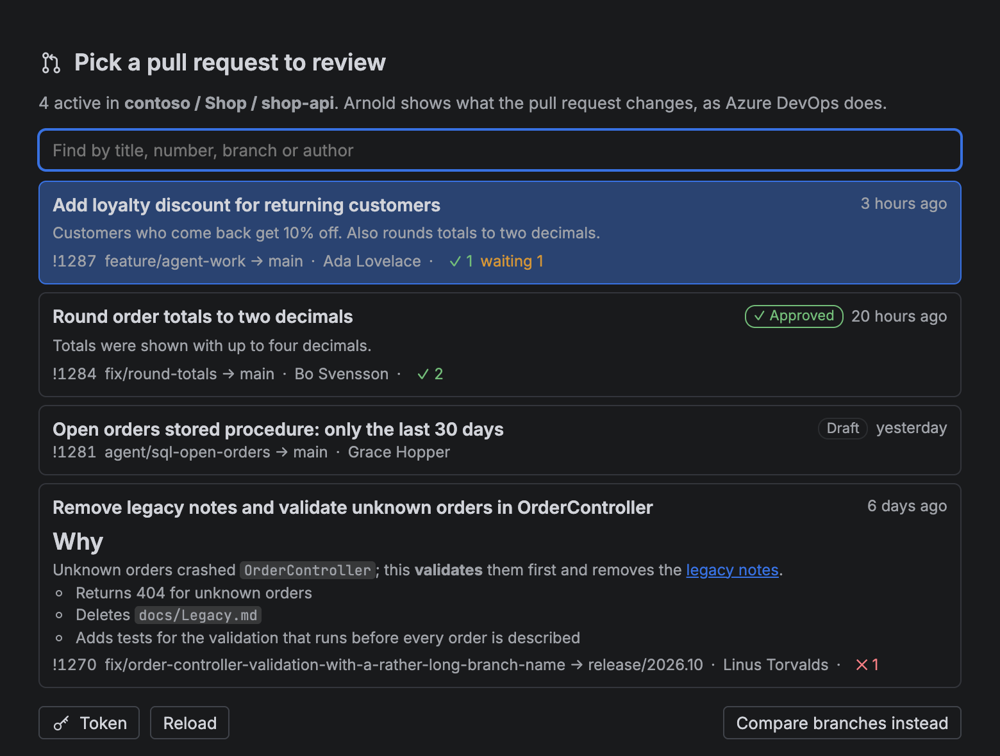

The one you pick is compared the way Azure DevOps does it: the merge-base of its target and source → the source branch's last commit, with the same commit picker. Commits the repository lacks are fetched from Azure DevOps into its object store only; no branch, remote-tracking branch or `FETCH_HEAD` changes. Arnold checks the pull request for new pushes, votes and discussions every minute while its window is shown, and when you come back to it.

### Discussions and comments

Discussions show as cards under the lines they are about, with resolved ones folded and the unchanged lines around them unfolded. Discussions about a whole file sit at the top of its diff. The comment button in the toolbar lists every discussion, including those about the pull request as a whole, and jumps to the others.

To comment, right-click a line or a selection and choose *Add comment*, or right-click a file under *Changes* to comment on the whole file. Every discussion has *Reply*, and the toolbar list takes comments on the pull request as a whole. Your own comments and suggestions have *Edit* (to change their text in place) and *Delete* (after asking) when you point at them; others' comments have neither. Comments are Azure DevOps Markdown, with a preview: emoji shortcodes, `#123` work items, `!123` pull requests, suggestion blocks and task lists. `Ctrl+Enter` (`⌘+Enter`) sends.

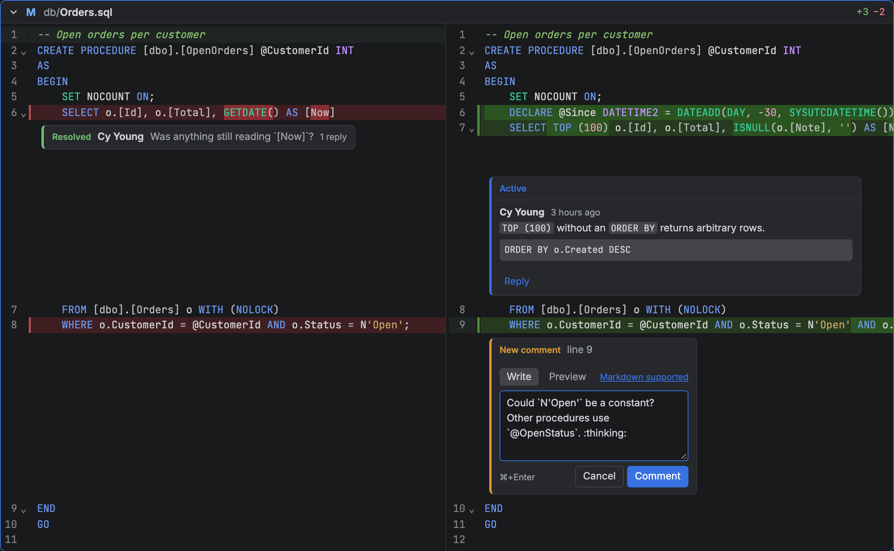

Discussions show with all changes only: a commit picked in the commit picker has other line numbers.

### Suggesting changes

Rather than describing a fix, make it: type into the diff. Opening a pull request checks it out detached at its latest push: in the opened folder, or, if that has uncommitted changes and you would rather keep them, in a git worktree of its own, `.arnold/worktrees/pr-<id>` (see [Checking out](#checking-out)). F# language features run in that checkout, so they see your edits.

Editing works as in [Editing while comparing](#editing-while-comparing): saved as you type, framed in amber, undone from the right-click menu (files are not marked *edited* here: edits are only a way to make suggestions). As soon as you change something, a *Suggest* button shows on a row of its own under it. It turns that change into an Azure DevOps suggestion comment on the lines it replaces, which the author can apply with a click; add a message if you like. Once posted, it shows as every open suggestion does: the lines it would replace framed in amber, and the suggested code in the same frame in its discussion. New and deleted files cannot be suggested.

A checkout without edits follows new pushes by itself. If the pull request gets a new push while you have edits, the checkout keeps them on the earlier push (their lines no longer match it) and the diff turns read-only; *Read-only* in the status bar offers to throw them away and edit the latest push. Arnold does not remove worktrees.

### Voting and completing

As in Azure DevOps, the toolbar has *Approve* and *Complete*:

- **Approve** votes in one click. Its menu has *Approve with suggestions*, *Wait for author*, *Reject* and *Reset feedback*, and the button then shows your vote.
- **Complete** opens a dialog with the merge type (merge, squash, rebase and fast-forward, semi-linear), the commit message, and whether to complete the linked work items and delete the source branch. It reads the target branch's policies: merge types that "Limit merge types" does not allow are disabled, and while required policies (reviewers, builds, comments, ...) are not met, it lists them and does not complete. It warns about merge conflicts and reviewers who rejected or are waiting for the author. Arnold completes only the source commit you were shown, so a push you have not seen is refused.
- Complete's menu has **Mark as draft** and **Abandon**. A draft shows *Publish* instead of *Complete*, an abandoned pull request *Reactivate*.

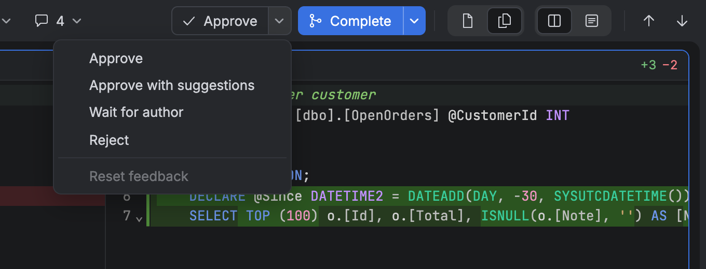

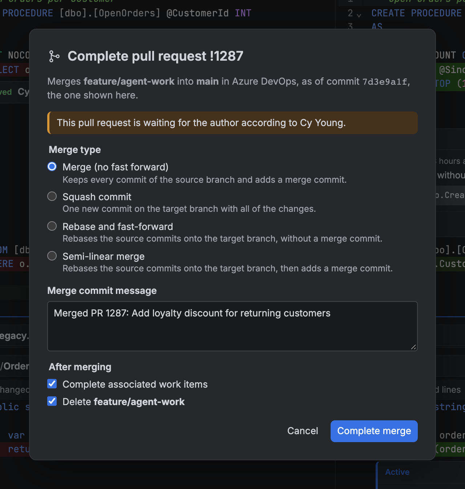

## F#

### Language features

In F# files the diff has errors and warnings, hover, go to definition (`F12`, `Ctrl`/`Cmd`+click or the context menu; *Back* returns), find references (`Shift+F12`), semantic colors, and unused `open`s faded out. Where the diff can be edited (everywhere but a picked run of commits) there are FsAutoComplete's quick fixes and refactorings, such as *Remove unused open*: `Alt+Enter` or `Ctrl+.` / `Cmd+.` lists those for the cursor's line or the selection at the cursor, as do *Quick fixes…* in the right-click menu and the hover card of an error or hint where they are clicked (hover cards, too, open at the pointer); `↑`/`↓` and `Enter` pick one, which edits the file like typing would (in a pull request, into a suggestion). *Remove unused opens* in the right-click menu removes every unused `open` of the file at once. *Rename…* (`F2`, or `Ctrl+R` `Ctrl+R` as in Visual Studio) renames the symbol under the cursor everywhere FsAutoComplete finds it: type the new name in the box on the symbol and press `Enter`. Files on screen change like typing would; the others are changed on disk in the checkout and show up as edited. There is completion and signature help too: the list comes up as a name starts or after a dot (`Ctrl+Space` asks anywhere), narrows as you type, shows the highlighted item's signature and documentation beside it, and `Tab` or `Enter` takes it. The file headers of the all-files view count the errors of every changed F# file.

The *Problems* panel under the diff lists them all, as the error list of Rider and Visual Studio does: every error, warning and message FsAutoComplete reported, file by file, with buttons to show or hide each kind. Open it with the error and warning counts in the status bar or `Ctrl+Shift+M` (`Cmd+Shift+M`); clicking a problem goes to it (*Back* returns). FsAutoComplete checks the files it has open, so the list covers the files shown and the changed F# files, not every file of the solution.

To check all of it, build: *Build* in the panel's header or `Ctrl+Shift+B` (`Cmd+Shift+B`) runs `dotnet build` in the checkout the language server runs in, on the solution nearest the top (or, without one, every F# project), restoring as needed. The errors, warnings and messages it reports go into the panel, in any file and project, C# included; what FsAutoComplete reported before is dropped as the build starts, since it may be stale, and comes back as the server checks files again (a problem both report is listed once). The status bar shows the build under way; *Cancel build* there or in the panel stops it.

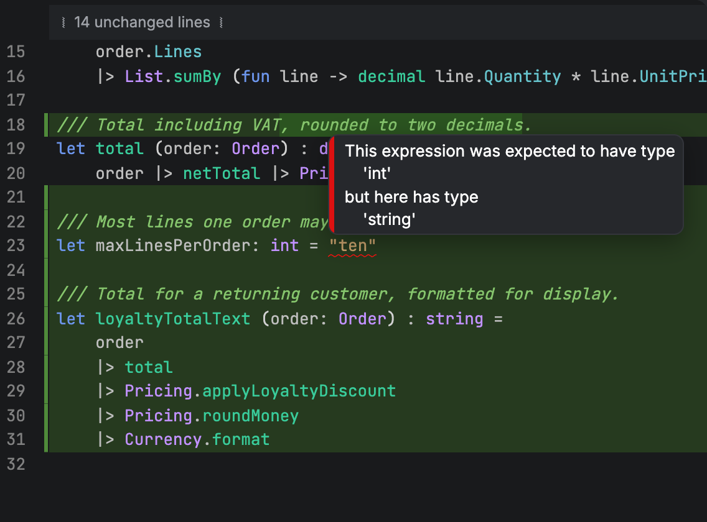

The language server needs the code on disk with its packages restored. It runs in the reviewed branch's checkout (the opened folder, a linked worktree or the branch's own worktree), the pull request's checkout, or *Commit*'s checkout, and sees edits there. While it does, the review goes on as usual (`dotnet` runs below normal priority, and what it writes to the folders git ignores, such as `obj` and `bin`, does not refresh the lists); the status bar shows how far it has come, and its popup lists each step, problems, the output of `dotnet` and the build log of a project that failed. If something fails, the review goes on without language features, or with gaps.

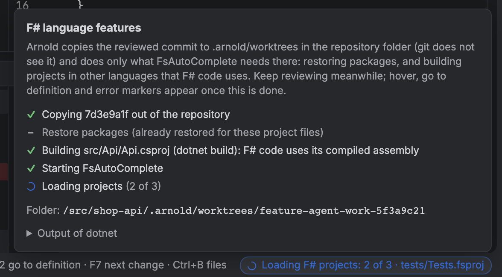

How it works:

- Arnold uses [FsAutoComplete](https://github.com/ionide/FsAutoComplete) (Apache-2.0), which is not bundled. The first time an F# file is shown, Arnold downloads the latest release from nuget.org into its own data folder, checks it against the SHA-512 hash NuGet publishes, and starts it. Nothing is installed globally.
- After that it starts the installed copy straight away and, at most once a day, looks for a newer release in the background; a new one is used from the next start. Old versions are removed.
- It needs the .NET SDK (8 or newer). The SDK the repository selects (`global.json`) decides which build of the server runs.
- Only when no checkout of the reviewed commit can be had (checking out failed or was cancelled, or a pull request's checkout holds edits to an earlier push) does it run in a copy of the commit instead, `.arnold/worktrees/<branch>-<hash>`, without edits. Arnold does only what FsAutoComplete needs there: `dotnet tool restore` and `dotnet restore` when project or package files changed since the last restore in that folder, and `dotnet build` only for projects in other languages (such as C#) that F# projects reference, when their files changed. F# projects themselves are never built. Files git ignores are not in a new worktree: for an [Elmish Land](https://elmish.land) app (`elmish-land.json` and the tool in the manifest) Arnold runs `dotnet elmish-land restore` first, when `.elmish-land/` is missing or pages or settings changed, and any other project reference missing on disk is listed as a problem, since FsAutoComplete then fails to load the projects (that failure is shown too). A new commit updates the copy in place, so restore and build output are reused.
- The server stops when Arnold closes or you pick another branch.

### Fantomas

When the repository uses [Fantomas](https://fsprojects.github.io/fantomas/) (it is in `.config/dotnet-tools.json` or `dotnet-tools.json`), *Commit* first runs `dotnet tool run fantomas --check .` on the checkout, restoring the repository's tools if needed. If Fantomas would change files, or cannot check them, Arnold lists them and asks:

- **Run Fantomas and commit** formats the files Fantomas listed and stages only their formatting, then commits. A listed file without other unstaged changes is staged whole; one with other unstaged changes gets its staged text formatted (through a short-lived copy beside it, so the same `.editorconfig` applies) and keeps those changes unstaged, formatted on disk. Other unstaged files stay as they are. If Fantomas cannot format a file as staged, nothing is committed.
- **Commit without formatting** commits as it is.
- **Cancel** does neither.

Files Fantomas cannot parse are listed separately; they are left as they are.

## Explaining and improving code with AI

The ✦ button at the right of the toolbar (`Ctrl+Shift+A`, `Cmd+Shift+A` on macOS) opens a panel where GitHub Copilot explains the code under review. Ask about:

- **a selection or a line**: right-click it in the diff, *Explain selection* / *Explain this line*. Copilot gets the lines, the file's changes and, for files up to 60 KB, the whole file, of the side you clicked (old or new);
- **a file or folder**: *Explain changes* in the Changes list, the explorer, and Commit mode's Unstaged and Staged lists (several picked files at once there). A file without changes is explained whole;
- **everything**: *Explain all changes* in the panel: the branch, the pull request (with its title, description and commits) or, in Commit mode, the uncommitted changes. Up to about 150 KB of diff is sent; binary files, lock files and whatever does not fit are named but left out.

Then ask follow-up questions in the box below; *New chat* starts over. `path:line` references in answers open the code, and *Back* returns.

### Suggesting improvements

*Suggest improvements* in the panel has Copilot review all the changes under review: the branch, the pull request or, in Commit mode, the uncommitted changes. It is told to suggest a change only where one of two things holds, and to say which:

- **Repository pattern**: the change departs from a convention the existing code clearly follows (naming, error handling, structure, the helpers and libraries it uses), and Copilot names where the existing code does it;
- **Proven practice**: a well-established reason that does not depend on taste, such as a bug, an unhandled error or edge case, a security problem, a resource leak, clearly worse performance, or a documented best practice of the language or library.

Matters of taste, formatting and lines the change did not touch are left alone, and no suggestions is a fine answer. To judge the repository's patterns, Copilot gets the diff, the whole new version of each changed file and a few unchanged files with the same extension from the same folders (about 110 KB of files at most, besides the diff).

Each suggestion shows in the diff as a card under the lines it would replace (framed in blue): why, the lines removed and added, and **Accept** and **Discard**. *Accept* replaces the lines like typing would, in the editor that shows the file or, when none does, in the file on disk in the checkout; the change is then an edit like any other, to review, undo or commit. Accepting needs the diff to be editable (a checkout of the branch or pull request, or Commit mode). A suggestion is placed by its text, not its line number, so edits above it move it along; once its lines are edited, it is no longer shown.

The panel lists the suggestions under a short summary of the changes, as a starting point: a click on one shows its code, and each can be accepted or discarded there too. Suggestions whose lines Copilot got wrong are left out, and counted. Follow-up questions in the panel know what was suggested.

**Your organization's Copilot.** Arnold has no AI service or account of its own. It signs in with your GitHub account and uses the [GitHub Copilot](https://github.com/features/copilot/plans) your organization already provides (Copilot Business or Enterprise), or your own plan if you have one (the free plan works too). That makes it as safe as Copilot already is for you:

- the code you ask about goes only to GitHub Copilot, under the agreement your organization has with GitHub; Arnold has no server of its own and sees nothing;
- your organization's Copilot policies apply, as GitHub enforces them: whether Copilot CLI may be used at all, and which models are allowed. The model menu at the top of the panel lists the models your plan offers; *Auto* lets Copilot pick;
- usage counts against your Copilot seat, like any other Copilot use.

**Signing in.** *Sign in with GitHub* shows a code and opens github.com/login/device, where you enter it and approve Arnold; the sign-in is kept in the macOS Keychain or Windows Credential Manager. Without one, a token in `COPILOT_GITHUB_TOKEN`, `GH_TOKEN` or `GITHUB_TOKEN` is used.

**How it works.** Answers come from GitHub's [Copilot SDK](https://github.com/github/copilot-sdk) and the GitHub Copilot CLI it drives, which Arnold downloads from GitHub the first time (about 115 MB) into its own data folder; each Arnold release pins its version. The CLI keeps its state in that folder too, not in `~/.copilot`. Copilot is given no tools: it cannot read other files or run anything, only answer from what Arnold sends. The code you ask about is sent to GitHub Copilot with your question; usage counts against your Copilot plan.

## Keyboard shortcuts

| Keys | What they do |
|---|---|
| `F7` / `Shift+F7` | Next / previous change (across files in the all-files view) |
| `Ctrl+F` (`Cmd+F`) | Find in the file: the selection, else the last text searched for; every match is highlighted and marked on the scrollbar, and folded unchanged lines open for the match stepped to |
| `Enter` / `Shift+Enter`, `F3` / `Shift+F3`, `Ctrl+G` / `Ctrl+Shift+G` (`Cmd+G` / `Cmd+Shift+G`) | Next / previous match, wrapping around |
| `Alt+C` / `Alt+W` / `Alt+R` (`⌥C` / `⌥W` / `⌥R`) | In the find box: match case / whole words / regular expression |
| `Ctrl+H` (`Cmd+Alt+F`) | Find and replace, where the diff can be edited |
| `F12`, `Ctrl`/`Cmd`+click | Go to definition (F#) |
| `Shift+F12` | Find references (F#) |
| `Alt+Enter`, `Ctrl+.` (`Cmd+.`) | Quick fixes and refactorings for the cursor's line or the selection (F#, where the diff can be edited) |
| `F2`, `Ctrl+R` `Ctrl+R` | Rename the symbol under the cursor in every file (F#, where the diff can be edited) |
| `Ctrl+-` (macOS), `Alt+←` (Windows) | Back to where you jumped from |
| `Ctrl+B` (on macOS also `Cmd+B`) | Hide or show the files dock |
| `Ctrl+Shift+A` (on macOS also `Cmd+Shift+A`) | Open or close the AI panel |
| `Ctrl+Shift+M` (on macOS also `Cmd+Shift+M`) | Open or close the Problems panel |
| `Ctrl+Shift+B` (on macOS also `Cmd+Shift+B`) | Build the solution, listing its problems in the Problems panel |
| `S` / `U` / `R` | Commit mode: stage / unstage / reset the file (lists) or the selected lines (diff; where text can be typed, plain keys need a selection and `Alt`/`⌥` acts on the cursor's line) |
| `Del` (on macOS also `⌫`) | Commit mode: delete the picked files of Unstaged or Staged from disk, after asking |
| `Tab` / `Shift+Tab` | Commit mode, where text can be typed: indent / outdent, in the file's own indentation (tabs, or its step of spaces); `Esc` then `Tab` leaves the editor |
| `Ctrl+Enter` (`⌘+Enter`) | Commit; send a comment |
| `Esc` | Close a menu, popup, dialog or the find box; cancel a comment |

## What Arnold writes

Reviewing writes nothing to the repository's files until you edit. Edits you make while comparing a branch are saved to its checkout, and so is a Copilot suggestion you accept. *Commit* mode changes the checkout picked there, and only when you ask: saving edits, staging and unstaging, resetting files or lines (after asking, except for undoable line resets), deleting files (after asking), formatting with Fantomas and staging the formatting (after asking), creating a branch to commit on when the checked-out one takes pull requests only (after asking), committing, and pulling and pushing the branch. *Add to .gitignore* in the explorer (and on untracked files in *Unstaged*) appends a line to the checkout's root `.gitignore`, and *Stop tracking…* stages the removal of files from the repository (`git rm --cached`), keeping them on disk. Otherwise Arnold writes only:

- the objects of a pull request it fetched;
- when you create a pull request from a branch Azure DevOps does not have (or has an older commit of): the reviewed commit, pushed to that branch without forcing, and the remote-tracking branch moved to it;
- when you compare a branch checked out nowhere, or pick one in *Commit*: the branch checked out in the opened folder (`git switch`), or, when that has uncommitted changes, what you pick: a registered git worktree of it, `.arnold/worktrees/<branch>` inside the repository folder (like Claude Code's `.claude/worktrees`; a `.gitignore` there keeps it out of `git status`), or the folder after stashing its changes (`git stash push --include-untracked`) or throwing them away (`git reset --hard` and `git clean -d --force`); for a remote branch `origin/x` without a local branch, a local branch `x` that tracks it;
- for the language server: the output of `dotnet restore` (and of building referenced non-F# projects, when needed) in the `obj` and `bin` folders of the checkout it runs in, as building it yourself would, and when you build (`Ctrl+Shift+B`) the output of `dotnet build` there; only when no checkout can be had, a copy of the reviewed commit in `.arnold/worktrees/<branch>-<hash>` (not a registered worktree);
- while running *Run Fantomas and commit* on a file that also has unstaged changes: a short-lived copy of its staged text beside it (`<name>.arnold-staged.fs`), deleted as soon as Fantomas has formatted it;
- to the remote, when you select *Push* or *Push & create PR* in *Commit*: the branch checked out, never forced, with its upstream set the first time;
- from the remotes, when you select *Fetch* in a branch picker or *Pull* in *Commit*: every branch into the remote-tracking branches (deleted ones dropped), and local branches checked out nowhere that are only behind moved up to their remote; *Pull* also fast-forwards or merges the branch checked out;
- to Azure DevOps, when you ask it to: new pull requests (linked to a work item if you give one), comments and suggestions, votes, and completing, abandoning, drafting or publishing a pull request;
- when you open a pull request: its latest push checked out detached, in the opened folder or (as for a branch) in a registered git worktree, `.arnold/worktrees/pr-<id>`, holding your edits until you suggest or undo them; `.arnold/pull-request` notes which pull request the folder has.

Outside the repository, explaining code and suggesting improvements with AI send the code you ask about (for suggestions, also a few unchanged files beside the changed ones) to GitHub Copilot, keeps your GitHub sign-in in the system's credential store, and keeps the Copilot CLI and its state in Arnold's data folder.

## Status

Arnold is young and changes often; every push to `main` is released. It is used mostly on macOS; the Windows build is released alongside it. The Windows build is signed; the macOS build is not yet ([`Signing.md`](Signing.md) has the plan).

Not there yet: C# language server, a problems list with messages, settings, GitHub pull requests, and in Azure DevOps: auto-complete, resolving or editing discussions, and adding reviewers.

## License

Arnold is released under the [MIT License](LICENSE). FsAutoComplete, which Arnold downloads, is under its own Apache-2.0 license.

Arnold is built on several hundred open source packages (Rust crates and npm packages, all under permissive licenses such as MIT, Apache-2.0, BSD and, for the Inter and JetBrains Mono fonts, the SIL Open Font License). Their license texts ship with every build: *Open Source Licenses…* in the Arnold menu on macOS, or *Licenses* in the popup of the version in the status bar. `npm run notices` ([`scripts/third-party-notices.mjs`](scripts/third-party-notices.mjs)) collects them into `public/third-party-notices.json`; `npm run build` runs it, so the list always matches what was built.

JetBrains and Rider are trademarks of JetBrains s.r.o. Arnold's look follows Rider's *Islands Dark* theme (its colors come from JetBrains' Apache-2.0 [rider-theme-pack](https://github.com/JetBrains/rider-theme-pack) and [intellij-community](https://github.com/JetBrains/intellij-community)), but Arnold is an independent project, not affiliated with or endorsed by JetBrains.

## The name

Arnold is named after Arnold Rimmer, the hologram in the TV show *Red Dwarf*. People who describe his personality tend to reach for the word *git*, British slang for an unpleasant, annoying person, which is also where git itself got its name. This app works with git, so it is named after one.

The icon is the **H** Rimmer wears on his forehead to mark him as a hologram, drawn as a git graph: two branches joined by a crossbar, with a commit at each end. The red and green commits are the removed and added lines of a diff.

## Development

Arnold is built with [Tauri 2](https://tauri.app) (Rust), SolidJS and CodeMirror 6.

### Requirements

- `git` on PATH
- Rust (1.90+) and Node.js

### Run

```bash
npm install
```

```bash
npm run tauri dev -- -- path/to/repository
```

The path is optional; without it Arnold reopens the last repository, or use *Open repository…*. Either way it starts on the branch checked out there.

Build the app, and on Windows its installers:

```bash
npm run tauri build
```

On macOS the installer is a separate step:

```bash
src-tauri/installer/macos/build-pkg.sh target/release/bundle/macos/Arnold.app 0.1.0 Arnold.pkg
```

### Releases

Every push to `main` is built by [`.github/workflows/release.yml`](.github/workflows/release.yml) for macOS (Apple silicon) and Windows (x64) and published under [Releases](https://github.com/reaptor/arnold/releases). Pushes that change only the website (`site/`) or [`.github/workflows/pr-screenshots.yml`](.github/workflows/pr-screenshots.yml) (which deletes a pull request's screenshot branch once it is closed) build no release.

The version goes up with every commit: `<major>.<minor>` comes from `src-tauri/tauri.conf.json` and the patch number is the number of commits on `main`, so the 57th commit is released as `v0.1.57`. To start a new minor or major version, change the version in `src-tauri/tauri.conf.json`. Local builds keep the version written in that file.

### Website

[arnoldapp.dev](https://arnoldapp.dev) is a static Astro site in [`site/`](site/), served from Docker behind Traefik; [`site/README.md`](site/README.md) has how to run and deploy it.

### Commands

| Command | What it does |
|---|---|
| `npm run dev` | UI alone in a browser at <http://localhost:1420>, against an in-memory stand-in backend (`src/ipc/devMock.ts`); see the options below |
| `npm test` | Frontend unit tests |
| `cargo test --workspace` | Backend tests (create temporary git repositories) |
| `cargo test -p arnold-lsp --test fsautocomplete_live -- --ignored --nocapture` | Downloads and runs the real FsAutoComplete on a small project |
| `GH_TOKEN=$(gh auth token) cargo test -p arnold-ai --test copilot_live -- --ignored --nocapture` | Downloads the Copilot CLI into a temporary folder and asks real Copilot about a diff, and for suggestions in the JSON the app reads (needs an account with Copilot and no Arnold sign-in in the keychain) |
| `cargo test -p arnold-pr -- --ignored` | Checks that dev.azure.com turns down a bogus token |
| `npm run notices` | Collects the license texts of every crate and npm package built into Arnold into `public/third-party-notices.json` (shown under *Licenses*; `npm run build` runs it) |
| `npm run screenshots` | Retakes the screenshots in `docs/screenshots/` from `npm run dev` (needs Google Chrome); `npm run screenshots -- review` takes one |
| `src-tauri/make-icons.sh` | Regenerates `src-tauri/icons/` from the icon source, `src-tauri/app-icon.svg` |

Options of the stand-in backend, added to the URL (`?devops&lsp`):

| Option | What it does |
|---|---|
| `devops` | An Azure DevOps remote with a saved token and five pull requests (!1270 has merge conflicts); `=nopat` without a token (pasting `bad` is rejected), `=rejected`, `=empty`. !1291 has a diff and discussions of its own (an F# discounts module, one discussion holding a suggestion), for trying editing and *Suggest changes*: `arnoldMock.newPush()` in the browser console gives it a new push, which shows on the next check (reload in the pull request list, or the window regaining focus); `arnoldMock.devopsRemote(false)` / `(true)` removes or adds the remote, as `git remote` would |
| `uncommitted` | The checkout has an agent's uncommitted work (edits, a partly staged file, an untracked and a deleted file), so the repository opens in *Commit*; `failcommit` makes committing fail as a hook would |
| `nosolution` | The stand-in repository has no solution or project files, so *All files* shows only the folder tree |
| `notcheckedout` | The folder is on `main`, so `feature/agent-work` is checked out in it when compared; `dirtyfolder` also gives `main` uncommitted changes, so Arnold asks whether to use a worktree or discard them; `checkoutfail` makes checking out fail, so the comparison is read-only |
| `unformatted` | The repository uses Fantomas and it would reformat files; `=many` lists more than the dialog shows, `=errors` adds a file it cannot parse, `=fail` makes the check fail |
| `failpush` | Pushing the branch from *Commit* fails |
| `policies` | `feature/agent-work` has required branch policies on Azure DevOps, so committing asks for a new branch; `=fail` makes the check fail, and committing goes ahead |
| `readonlytoken` | Writing to pull requests fails, as with a Code (Read) token |
| `workitems=noaccess` | The token may not read work items. Otherwise work items below 90000 exist (1234 has a real title) and higher numbers do not |
| `serverbranch` | For *Create pull request* from `feature/agent-work-wt` (not on the server otherwise): `=behind` one commit behind, `=ahead` with a commit that was not reviewed. `feature/agent-work` has !1287 open already |
| `lsp` | A stand-in language server that answers go-to-definition, hover, completion and rename, and reports unused `open`s with a *Remove unused open* fix; `projectfail` makes a project fail to load, `workspacefail` makes the whole workspace fail |
| `setupslow`, `setupfail` | Preparing the language server's copy is slow, or fails |
| `ai` | Signed in to GitHub with Copilot ready: answers are a stand-in that lists what was sent; `=new` downloads Copilot first, `=signedout` (also without the option) signs in with a code, `=nosub` cannot start Copilot, `=error` makes questions fail; *Suggest improvements* gets stand-in suggestions for the first changed files (and one whose lines are not there), `=noreview` none, `=badreview` an answer that is not JSON |
| `files=40` | Adds that many changed files, for a large diff |
| `platform=windows` | Shows the Windows title bar |

### Layout

| Path | Contents |
|---|---|
| `src/` | UI: SolidJS + CodeMirror 6 (`@codemirror/merge`) |
| `src-tauri/` | Tauri shell: commands, file decoding, branch and checkout watchers, preparing the language server's copy |
| `src-tauri/installer/` | What the installers add: the `arnold` and `ace` commands and the PATH setup |
| `crates/arnold-git/` | Git through the `git` CLI: reading for the review, checking branches and pull requests out, in the folder or in worktrees (`worktree.rs`), copying a commit's files out, and staging and committing for Commit mode (`working.rs`) |
| `crates/arnold-pr/` | Pull requests of code hosts: Azure DevOps remotes, its REST API, tokens in the system credential store |
| `crates/arnold-ai/` | Explaining code with AI: the provider interface, GitHub sign-in (device flow), downloading the Copilot CLI and talking to it through the Copilot SDK, and the prompt |
| `crates/arnold-lsp/` | Language servers: install/update, the minimal restore/build plan, and the proxy between editor and server; running Fantomas (`fantomas.rs`; formatting and staging before a commit is `src-tauri/src/formatting.rs`) |
| `scripts/` | Taking the README's screenshots |
| `docs/screenshots/` | The README's screenshots |
